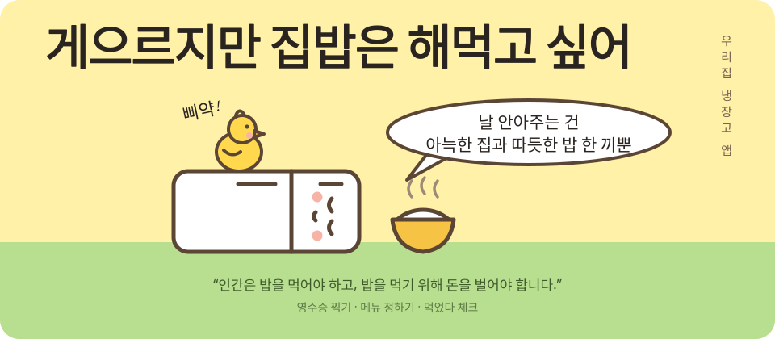
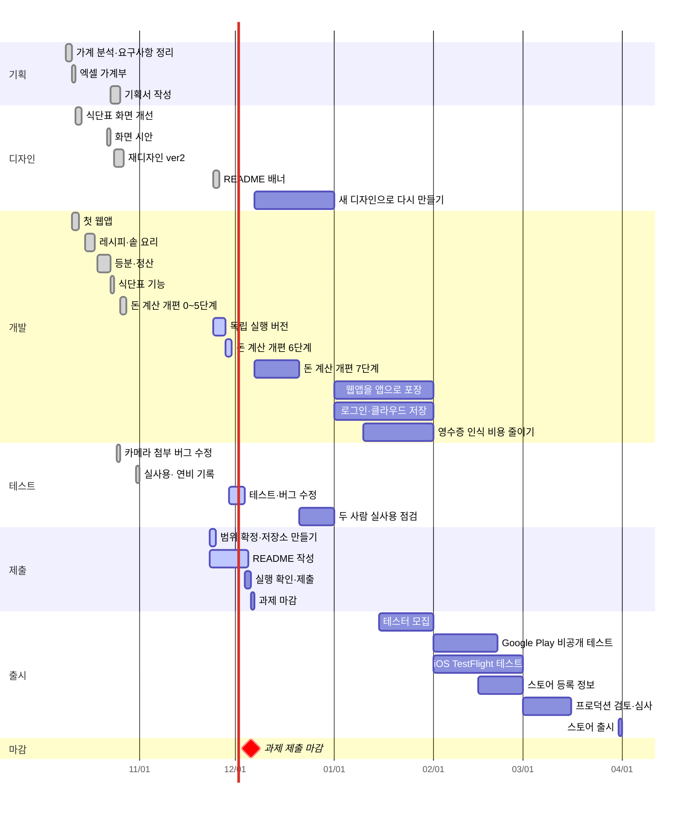

<div align="center">



<p>
  
  
  
  
  
  
  <a href="LICENSE"></a>
</p>

**냉장고 재료를 한눈에 관리하고, 그 재료로 요리 계획을 세워 끼니를 해결하도록 돕는 2인 가구용 모바일 웹앱**

[주요 기능](#-주요-기능) · [실행 방법](#-실행-방법) · [계산 규칙](#-계산-규칙) · [개발 일정](#-개발-일정) · [개발 과정](#-개발-과정) · [참고 자료](#-참고-자료)

</div>

---

## 💡 왜 만들었나

가난하고 배고픈 대학생 둘이 동거하기 시작하면서 식비 절약을 위해 집밥을 해먹자고 다짐했습니다. 하지만 매번 메뉴를 정하고 재료를 준비하는 과정이 번거로워서 다짐을 지속하기가 어려워졌고, 둘 다 바쁜 시간이 반복되자 냉장고 현황을 자주 체크하지 못했습니다. 그러다보니 냉장고에선 새로운 생명이 탄생하고, 외식도 점점 늘어갔습니다.

여기서 AI에게 도움을 받을 수 있는 부분을 생각해보았습니다. 대충 입력해도 알잘딱깔센 알아듣는 AI를 이용해 냉장고를 게으르게 관리하고자 했습니다.

이 앱을 만든 취지는 집밥을 자주, 귀찮지 않게, 게으르게 할 수 있게 도와주는 냉장고 비서를 만드는 것이었습니다. 재료를 썩히지 않고 현명하게 소진하는 것부터 시작해서, 외식을 하지 않아서 아낀 비용을 보며 뿌듯함까지 챙기는 서비스입니다.

인간은 살기 위해 밥을 먹어야 하고, 밥을 먹으려면 돈이 있어야 합니다. 밥과 돈을 모두 관리해주면 인간의 생존 조건을 근본적으로 도와주는 것인 셈이죠. 즉, 삶의 질을 높이고 싶었습니다.

모든 1인 가구, 2인 가구들이 굶지 말고 잘 살았으면 좋겠습니다. 물론, 3인 이상 가구도요.

이 앱은 다음과 같은 과정을 하나로 이어줍니다.

<p align="center">
🛒 <b>장보기</b>
&nbsp;➡️&nbsp; 🥬 <b>영수증 자동 입력</b>
&nbsp;➡️&nbsp; 📝 <b>식단 계획</b>
&nbsp;➡️&nbsp; 🍽️ <b>먹음 처리</b>
&nbsp;➡️&nbsp; 💰 <b>재고·식비 반영</b>
&nbsp;➡️&nbsp; 🛒 <b>다음 장보기</b>
</p>

## 🙋 사람이 할 일, 🤖 비서가 할 일

사람이 할 일은 많지 않아요. 제일 중요한 건 맛있게 먹는 거고요.

| 🙋 사람 | 🤖 비서 |
| --- | --- |
| 🛒 장 보고, 📷 영수증을 찍는다 | 🤖 품목과 가격을 읽어 냉장고 재고와 가계부를 채운다 |
| 🍳 남은 재료 보고 메뉴를 정한다 | ⚙️ 그 재료에 '먹을 예정' 표시를 붙인다 |
| 👩‍🍳 요리해서 맛있게 먹는다 | 😊 맛있게 드세요! |
| ✅ 먹었으면 체크한다 | ⚙️ 재고를 빼고, 1인 단가를 계산하고, 지난 식단에 남긴다 |
| 🔄 계획이 바뀌면 그냥 바꾼다 (메뉴 옮기기, 혼자 먹기, 남겨 두기) | ⚙️ 재고·단가·기록을 바뀐 대로 다시 맞춘다 |
| 📝 마음에 든 요리는 레시피로 남긴다 | ⚙️ 레시피북에 모아 두고, 다음에 바로 찾게 한다 |
| 🚌 교통비 내역을 찍는다 (주유 영수증·계기판, 대중교통) | 🤖 교통비로 읽어 숨쉬기 비용에 더하고, 주유는 연비까지 계산한다 (예정) |
| ✍️ 대강 적는다 | ⚙️ 다 먹고 나면 정확한 양과 단가로 맞춘다 |
| 😌 아낀 돈 보고 뿌듯해한다 | ⚙️ 해먹은 끼니를 외식 기준가와 비교한다 |

🤖 AI가 하는 일 · ⚙️ 앱이 자동으로 계산하는 일

## ✨ 주요 기능

중요한 순서대로 적었습니다.

### 1. 🥬 냉장고 자동 기록

영수증만 찍으면 재고가 채워집니다. 재료 종류별 재고, 유통기한 신호등, 먼저 먹을 재료, 냉동 표시.

### 2. 💸 숨쉬기 비용

장을 보고 영수증을 입력하면 '이번달 숨쉬기 비용'을 계산해줍니다. 장 본 식재료, 휴지 같은 생활용품, 교통비까지. 숨만 쉬어도 나가는 돈을 한눈에 보여줍니다.

영수증 한 장으로 가계부까지. 식재료·생활용품·교통비(주유·대중교통)를 나눠서. 주유는 연비도 함께.

### 3. 🍽️ 끼니 기록

집밥은 생각보다 훨씬 유동적입니다. 어제 계획했던 메뉴가 오늘 바뀌고, 둘이 먹으려던 걸 혼자 먹고, 갑자기 치킨이 땡기고, 못 다 먹은 찌개가 며칠째 처치곤란입니다. 이 앱은 쉽게 바꾸고, 쉽게 확인하고, 기록은 알아서 맞게 따라옵니다.

먹음 체크 한 번에 재고 차감과 1인 단가. 메뉴가 바뀌면 옮기고, 혼자 먹으면 혼자 먹은 대로, 한 솥 요리는 여러 끼니에 나눠서. 유동적인 집밥을 그대로 기록.

### 4. 📖 레시피북

원래 해 먹던 레시피, 실제로 만들어 본 요리를 저장. 다시 먹고 싶을 때 검색 안 해도 됨.

### 5. 📅 지난 식단

자주 먹은 메뉴, 식비, 아낀 돈, 영양, 술 기록.

### 6. 💡 메뉴 추천

지금 재고로 만들 수 있는 요리.

<!-- 스크린샷·데모 GIF: docs/images/ 에 추가 예정 -->
> 📸 탭별 스크린샷과 사용 흐름 데모 GIF는 예시 데이터로 촬영해 추가할 예정입니다.

## 🚀 실행 방법

| 버전 | 상태 | 저장 | 영수증 인식 |
| --- | --- | --- | --- |
| 본 앱 (Claude 아티팩트) | 사용 중 | Claude 아티팩트 저장소 | Claude 내장 AI |
| 독립 실행 버전 (`app/`) | 만드는 중 | 브라우저 저장소(IndexedDB) | 직접 입력 또는 예시 결과 |

- 본 앱은 Claude 계정으로 로그인해야 저장된 데이터와 영수증 인식을 쓸 수 있습니다.
- 평가자와 누구나 로그인 없이 열어 볼 수 있도록 **독립 실행 버전**을 만들고 있습니다. 완성되면 `app/index.html`을 브라우저로 여는 방법과 GitHub Pages 주소를 이곳에 적습니다.
- 실제 영수증·식단·이름은 저장소에 올리지 않고, `data/sample/`의 예시 데이터로 시연합니다.

독립판의 [제출 일정과 완료 기준](app/README.md), [가상 영수증과 예상 결과](data/sample/README.md)를 함께 확인할 수 있습니다.

## 🧮 계산 규칙

| 항목 | 규칙 |
| --- | --- |
| 금액 단위 | 저장과 계산 모두 1원 단위. 나누고 남는 원은 마지막 항목에 붙여 합계를 맞춤 |
| 원본 금액 | 금액은 영수증 항목 한 곳에만 두고, 재고·끼니 금액은 모두 거기서 계산 |
| 배송비 | 같이 산 상품 개수로 똑같이 나눔 (같은 상품 3개면 3개로 셈) |
| 할인 | 영수증에 찍힌 행사 할인·쿠폰만, 가격에 비례해 나눔 (카드 할인·적립금 제외) |
| 재고 | 같은 재료를 또 사면 산 날·가격별 묶음으로 두고, 먼저 산 것부터 씀 |
| 1인 단가 | 그 끼니에 쓴 재료 금액 ÷ 먹은 사람 수. 여러 끼니에 나눠 먹는 요리는 다 먹은 시점에 실제 먹은 인분으로 나눔 |
| 외식 비교 | 외식 1끼 기준가 기본값 10,000원과 1인 단가를 비교 |
| 오토바이 연비 | 가득 주유 사이 주행거리(km) ÷ 그 사이 넣은 연료량(L) |

전체 규칙과 결정 기록은 기획서에 정리했습니다.

## 📅 개발 일정

일정은 [구글 시트](https://docs.google.com/spreadsheets/d/1r8RBJvEdbfDC4w6hNwSiXqFveHQJivf6P9-myf62BhA)에서 관리하고, 매일 GitHub Actions가 아래 배지와 차트를 자동으로 갱신합니다 ([`scripts/sync_schedule.py`](scripts/sync_schedule.py)).

<!-- schedule:start -->
   

전체 진행률 **48%** · 완료 14 · 진행 중 5 · 예정 14 (작업 33개) · 자세한 일정: [구글 시트](https://docs.google.com/spreadsheets/d/1r8RBJvEdbfDC4w6hNwSiXqFveHQJivf6P9-myf62BhA)

제출 진행률 **31%** · 필수 작업 6개 중 완료 0개


<!-- schedule:end -->

## 🛠 개발 과정

날짜별로 한 일과 그때 부딪힌 문제·결정은 [`docs/devlog/`](docs/devlog/)에 있습니다.

> 저장소는 2026-11-23에 만들었습니다. 그 전(2026-10-09 ~ 10-31) 작업은 개발 기록을 바탕으로 해당 날짜에 복원한 커밋이며, 커밋 메시지 앞에 `[기록 복원]`이 붙어 있습니다. 그 뒤로는 실제 작업한 날짜로 커밋합니다.

<details>
<summary><b>폴더 구조</b></summary>

```
app/              앱 코드 (독립 실행 버전)
data/sample/      예시 데이터 (실제 생활 데이터는 올리지 않음)
docs/devlog/      날짜별 개발 기록
docs/images/      배너·스크린샷·데모 GIF
docs/references/  개발에 참고한 공식 문서 정리
scripts/          일정 동기화 스크립트 (Python)
.github/          GitHub Actions 설정
```

</details>

## 📚 참고 자료

- [개발에 필요한 공식 문서 정리](docs/references/official-docs-gpt.md): Claude 아티팩트 저장·공유, MDN(날짜·파일 입력·IndexedDB), 식약처 소비기한·영양 DB, W3C 접근성, GitHub 문서
- 외부 코드·이미지·폰트를 쓰면 출처와 라이선스를 이곳에 적습니다. 배너 이미지는 직접 만든 SVG이며, 글씨체는 [Gaegu](https://fonts.google.com/specimen/Gaegu)와 [Gamja Flower](https://fonts.google.com/specimen/Gamja+Flower)(둘 다 SIL Open Font License)를 쓰는 글자만 골라 넣었습니다.

## 🤖 AI 사용 범위

### 앱에서 사용하는 AI

현재 본 앱은 Claude 아티팩트에서 영수증 사진을 읽습니다. Claude는 프로토타입의 임시 선택입니다. 독립판의 제출 기준은 로그인이나 AI 호출 없이 직접 입력하거나 ‘예시 영수증’을 선택해 한 끼를 기록할 수 있는 것입니다.

출시판의 AI 제공자와 적용 기능은 미정입니다. 첫 비교 대상은 기기 내 문자 인식(OCR)과 규칙 기반 품목 추출, 서버에서 사진을 읽는 멀티모달 모델입니다. 같은 가상 한글 영수증으로 품목·금액 오류, 수정 시간, 처리 시간, 장당 비용, 사진 전송·보관 범위를 비교합니다. 결과는 수정 가능한 초안으로 보여주고 사용자가 확정합니다. 재고 차감, 1인 단가, 외식 대비 차액은 확정값으로 앱이 계산합니다.

### 개발에 사용한 AI

| 도구 | 쓴 곳 |
| --- | --- |
| Claude (Anthropic) | 기획, 계산 규칙 설계, 코드 작성, 문서 작성. 해당 커밋에 `Co-Authored-By: Claude` 표시 |
| ChatGPT (OpenAI) | 공식 문서 조사, 제출 일정 정리, 진행률 동기화 코드와 시연 검산 사례 작성 |
| GitHub Copilot | PR 코드 리뷰 (예정) |

## 📄 라이선스

[MIT License](LICENSE) © 2026 khj1870-robotics
