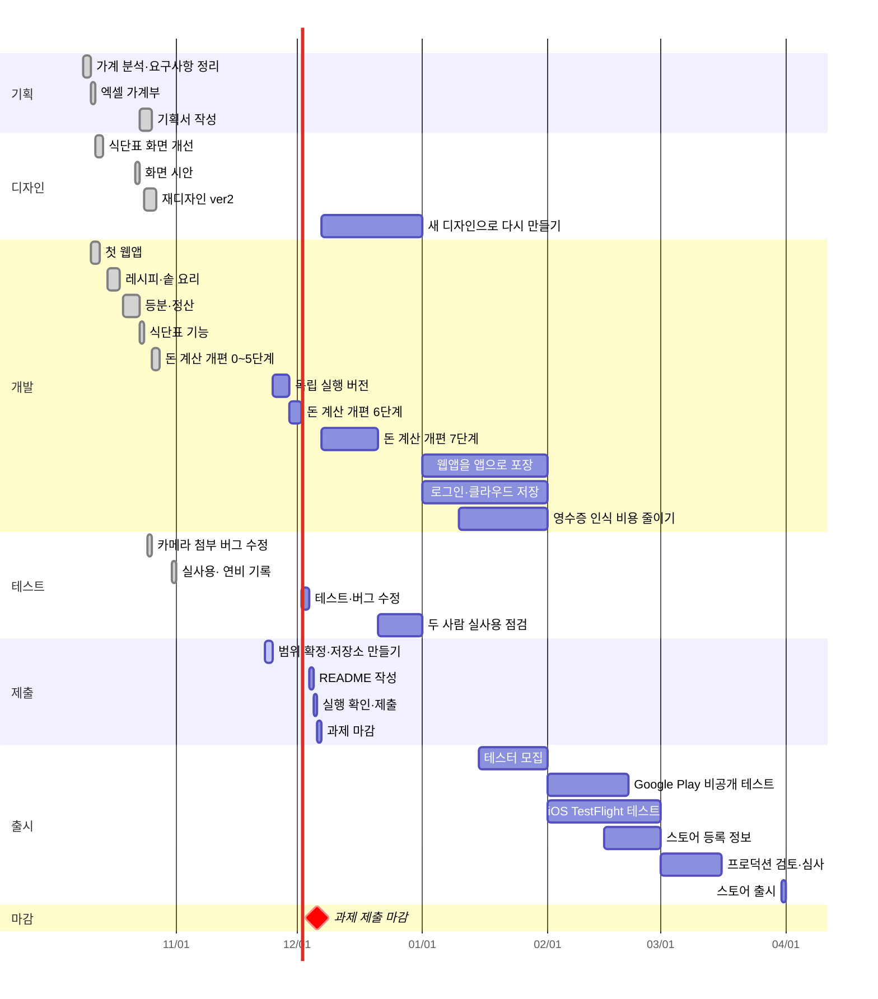

# 우리집 냉장고 (Our Home Fridge)

냉장고 재료를 한눈에 관리하고, 그 재료로 요리 계획을 세워 끼니를 해결하도록 돕는 2인 가구용 모바일 웹앱입니다.
목표는 **냉장고 관리부터 끼니 해결까지를 더 간편하게** 만드는 것입니다.

## 풀려는 문제

1. 유통기한이 임박한 재료부터 식단에 넣어, 버리는 재료를 줄입니다.
2. 장봐서 해먹는 것이 외식보다 얼마나 아껴지는지 한 끼 단가로 보여줍니다.

## 주요 기능

| 탭 | 기능 |
| --- | --- |
| 냉장고 | 칸별 재고, 유통기한 신호등, 먼저 먹기 표시, 냉동 표시, 꾹 눌러 옮기기, 재료를 솥에 넣어 요리 만들기 |
| 식단표 | 어제·오늘·내일 끼니, 재료 넣기, 먹음·건너뜀 처리, 도시락·외식 표시, 1인 단가 자동 계산 |
| 지난 식단 | 주간·월간 달력, 자주 먹은 메뉴·재료, 식비, 영양 비율, 술 기록 |
| 가계부 | 영수증 사진 인식, 식재료·생활용품 분리, 이번달 숨쉬기 비용, 오토바이 연비 |

스크린샷과 데모 GIF는 `docs/images/`에 추가할 예정입니다.

## 지금 상태와 실행 방법

- 지금 쓰는 앱은 HTML·CSS·JavaScript 한 파일로 된 웹앱이며, Claude 아티팩트 안에서 데이터 저장과 영수증 인식이 동작합니다.
- 내려받아 바로 실행할 수 있도록 저장을 브라우저 저장소(IndexedDB)로 바꾼 **독립 실행 버전**을 만들고 있습니다. 완성되면 `app/`에 넣고 실행 방법을 이곳에 적습니다.

## 개발 일정

일정은 [구글 시트](https://docs.google.com/spreadsheets/d/1r8RBJvEdbfDC4w6hNwSiXqFveHQJivf6P9-myf62BhA)에서 관리하고, 매일 GitHub Actions가 아래 차트를 자동으로 갱신합니다(`scripts/sync_schedule.py`).

<!-- schedule:start -->
전체 진행률 **41%** · 완료 13 · 진행 중 1 · 예정 18 (작업 32개) · 자세한 일정: [구글 시트](https://docs.google.com/spreadsheets/d/1r8RBJvEdbfDC4w6hNwSiXqFveHQJivf6P9-myf62BhA)


<!-- schedule:end -->

## 개발 과정

날짜별로 한 일과 그때 부딪힌 문제·결정은 [`docs/devlog/`](docs/devlog/)에 있습니다.

> 저장소는 2026-11-23에 만들었습니다. 그 전(2026-10-09 ~ 10-31) 작업은 개발 기록을 바탕으로 해당 날짜에 복원한 커밋이며, 커밋 메시지 앞에 `[기록 복원]`이 붙어 있습니다. 그 뒤로는 실제 작업한 날짜로 커밋합니다.

## 폴더 구조

```
app/            앱 코드 (독립 실행 버전)
docs/devlog/    날짜별 개발 기록
docs/images/    스크린샷·데모 GIF
data/sample/    예시 데이터 (실제 생활 데이터는 올리지 않음)
scripts/        일정 동기화 스크립트 (Python)
.github/        GitHub Actions 설정
```

## AI 도구 사용

- 기획, 계산 규칙 설계, 코드 작성, 문서 작성에 **Claude(Anthropic)**를 사용했습니다. 해당 커밋에는 `Co-Authored-By: Claude` 표시가 있습니다.
- 코드 리뷰에 **GitHub Copilot**을 사용할 예정입니다.

## 라이선스

[MIT License](LICENSE)
